<h2>TensorFlow-FlexUNet-Image-Segmentation-CVC-ClinicDB (2026/10/27)</h2>
Sarah T. Arai 
Software Laboratory antillia.com  

This is the first experiment of Image Segmentation for <b>CVC-ClinicDB </b>
 based on
our <a href="https://github.com/sarah-antillia/TensorFlow-FlexUNet-Image-Segmentation-Model">TensorFlowFlexUNet Model</a>
 (<b>TensorFlow Flexible UNet Image Segmentation Model for Multiclass</b>) and a 512x512-pixel upscaled PNG
 <a href="https://drive.google.com/file/d/1JNVdeHh36avltLnWCsuu4PoTwGYK5Dot/view?usp=sharing">
Augmented-CVC-ClinicDB-ImageMask-Dataset.zip</a> 
which was derived by us from the Kaggle  
  
<a href="https://github.com/openmedlab/Awesome-Medical-Dataset/blob/main/resources/CVC-ClinicDB.md">
<b>CVC-ClinicDB</b>
</a>
  

<b>Actual Image Segmentation for CVC-ClinicDB Images of 512x512 pixels</b> 
As shown below, the inferred masks resemble the ground-truth masks.  
 
<table>
<tr>
<th width="320" height="auto">Input: image</th>
<th width="320" height="auto">Mask (ground_truth)</th>
<th width="320" height="auto">Prediction: inferred_mask</th>
</tr>
<tr>
<td>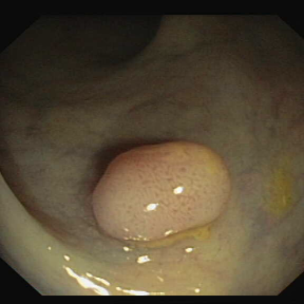</td>
<td></td>
<td></td>
</tr>
<tr>
<td>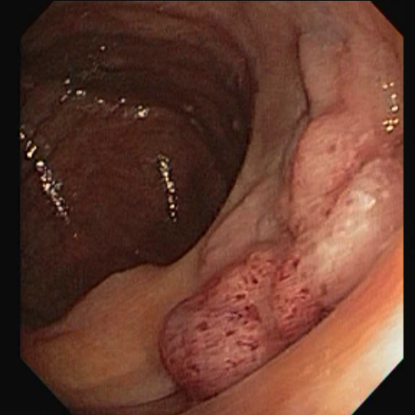</td>
<td></td>
<td>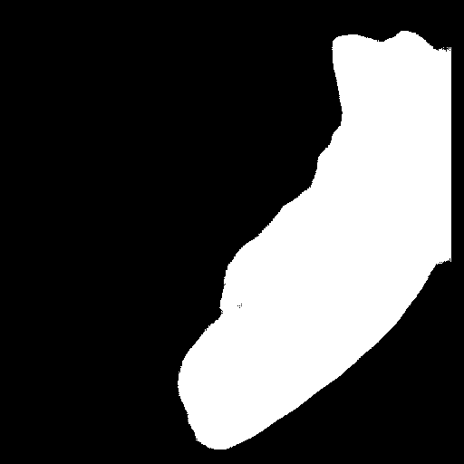</td>
</tr>
<tr>
<td>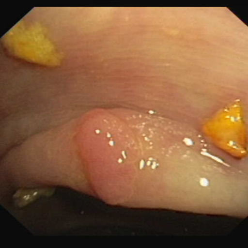</td>
<td>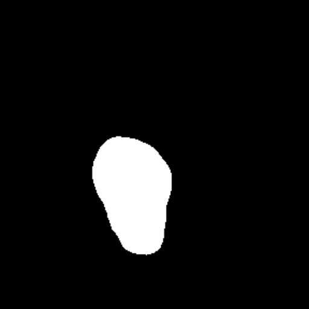</td>
<td>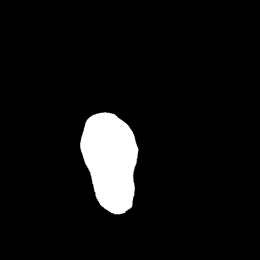</td>
</tr>
</table>

 
<h3>1. Dataset Citation</h3>
The dataset used here was derived from the following Kaggle:  
<a href="https://github.com/openmedlab/Awesome-Medical-Dataset/blob/main/resources/CVC-ClinicDB.md">
<b>CVC-ClinicDB</b>
</a>
  
The following explanation was taken the website above.
  
<b>Dataset Information</b> 
CVC-ClinicDB is the official dataset for the training phase of the MICCAI 2015 Endoscopic Video 
Automatic Polyp Detection sub-challenge. The database consists of 612 static images extracted 
from colonoscopy examination videos, originating from 29 different sequences.  
Each frame image is accompanied by a ground truth mask, which is used to identify the area covered by polyps in the image. Polyp segmentation is of significant importance when it comes to colonoscopy examinations and gastrointestinal tumor screening. By separating polyps from the surrounding normal tissues in medical imaging, a clearer visual reference is provided, helping doctors to accurately determine the location, shape, and size of the polyps. This is crucial for preliminary assessment 
of the nature of the polyps (benign or malignant) and for formulating corresponding treatment plans.
  
<b>Citation</b> 
<pre>
@article{bernal2015wm,
  title={WM-DOVA maps for accurate polyp highlighting in colonoscopy: Validation vs. saliency maps from physicians},
  author={Bernal, Jorge and S{\'a}nchez, F Javier and Fern{\'a}ndez-Esparrach, Gloria and Gil, Debora and Rodr{\'\i}guez, Cristina and Vilari{\~n}o, Fernando},
  journal={Computerized medical imaging and graphics},
  volume={43},
  pages={99--111},
  year={2015},
  publisher={Elsevier}
}
</pre>
 
For more information, please refer to <a href="https://gts.ai/dataset-download/cvc-clinicdb/">
CVC-ClinicDB 
</a> 
 
<b>License</b> 
Unknown
 
 
<h3>
2. CVC-ClinicDB ImageMask Dataset
</h3>
<h3>2.1 Download ImageMask Dataset</h3>
 If you would like to train this CVC-ClinicDB Segmentation model,
 please download the dataset from Google Drive  
 <a href="https://drive.google.com/file/d/1JNVdeHh36avltLnWCsuu4PoTwGYK5Dot/view?usp=sharing">
Augmented-CVC-ClinicDB-ImageMask-Dataset.zip</a>. 
Expand the downloaded ImageMaskDataset and put it under the <b>./dataset</b> folder.
 
<pre>
./dataset
└─CVC-ClinicDB
    ├─test
    │   ├─images
    │   └─masks
    ├─train
    │   ├─images
    │   └─masks
    └─valid
         ├─images
         └─masks
</pre>
 
<b>CVC-ClinicDB Statistics</b> 
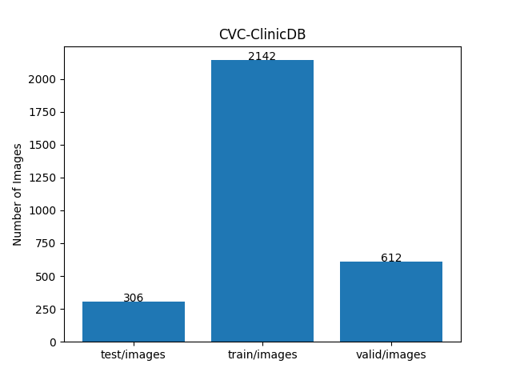 
 
As shown above, the number of images in the training and valid datasets is large enough to use for the
 training set of our segmentation model.
 
<h3>2.2 Derivation of ImageMask Dataset</h3>
The folder structure of the original dataset  
</a> is as follows.
<pre>
./CVC-ClinicDB
  ├─image
  │   ├─1.tif
...
  │   └─612.tif
  │
  └─masks
      ├─1.tif
...
      └─612.tif
</pre>
In this experiment, we geneated a 512x512-pixel upscaled PNG augmented ImageMask dataset  
from the original TIF images and masks by using some image flipping and rotation tools.
  
<h3>2.3 Train Sample Images and Masks</h3>
<b>Train_sample_images</b> 
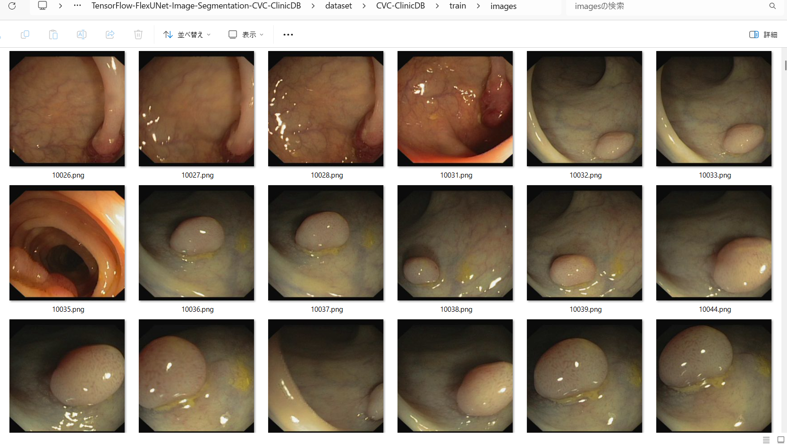
 
<b>Train_sample_masks</b> 
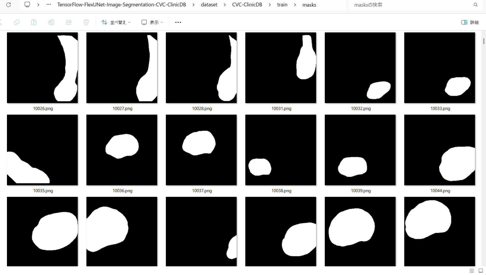
 
<h3>
3. Train TensorFlowFlexUNet Model
</h3>
 We trained the CVC-ClinicDB TensorFlowFlexUNet model using the following
<a href="./projects/TensorFlowFlexUNet/CVC-ClinicDB/train_eval_infer.config"> <b>train_eval_infer.config</b></a> file.  
Please move to ./projects/TensorFlowFlexUNet/CVC-ClinicDB and run the following bat file. 
<pre>
>1.train.bat
</pre>
This runs the following command. 
<pre>
>python ../../../src/TensorFlowFlexUNetTrainer.py ./train_eval_infer.config
</pre>

<b>Model parameters</b> 
Defined a small <b>base_filters=16 </b> and large <b>base_kernels=(11,11)</b> for the first Conv Layer of Encoder Block of 
<a href="./src/TensorFlowFlexUNet.py">TensorFlowFlexUNet.py</a> 
and a large <b>num_layers=8</b> (including a bridge between Encoder and Decoder Blocks).
<pre>
[model]
; You may specify your own UNet class derived from our TensorFlowFlexModel
model         = "TensorFlowFlexUNet"
generator     =  False
image_width    = 512
image_height   = 512
image_channels = 3
num_classes    = 2
base_filters   = 16
base_kernels   = (11,11)
num_layers     = 8
dropout_rate   = 0.05
; Specified a large dilation.
dilation       = (1,1)
</pre>
<b>Learning rate</b> 
Defined a small learning rate.  
<pre>
[model]
learning_rate  = 0.00007
</pre>
<b>Loss and metrics functions</b> 
Specified "categorical_focal_dice_loss" and <a href="./src/dice_coef_multiclass.py">"dice_coef_hybrid"</a>. 
<pre>
[model]
loss           = "categorical_focal_dice_loss"
metrics        = ["dice_coef_hybrid"]
hybrid_alpha   = 1.6
hybrid_beta    = 0.4
</pre>
<b>Dataset class</b> 
Specifed <a href="./src/ImageCategorizedMaskDataset.py">ImageCategorizedMaskDataset</a> class. 
<pre>
[dataset]
class_name    = "ImageCategorizedMaskDataset"
</pre>
 
<b>Learning rate reducer callback</b> 
Enabled the learning_rate_reducer callback and a small reducer_patience.
<pre> 
[train]
learning_rate_reducer = True
reducer_factor     = 0.4
reducer_patience   = 4
</pre>
<b>Early stopping callback</b> 
Enabled early stopping callback with the patience parameter.
<pre>
[train]
patience      = 10
</pre>

<b>RGB Color map</b> 
Specified RGB color map dict for CVC-ClinicDB 2 classes. 
<pre>
[mask]
mask_datatype= "categorized"
mask_file_format = ".png"
; CVC-ClinicDB RGB color map dict for 1+1 classes.
;      Background: black, Polyp: white 
rgb_map = {(0,0,0):0,(255,255,255):1,}
</pre>

<b>Epoch change inference callback</b> 
Enabled <a href="./src/EpochChangeInferencer.py">epoch_change_infer callback</a></b>. 
<pre>
[train]
epoch_change_infer       = True
epoch_change_infer_dir   =  "./epoch_change_infer"
num_infer_images         = 6
</pre>

By using this callback, on every epoch change, the inference procedure can be called
 for 6 images in the <b>mini_test</b> folder. This will help you confirm how the predicted mask changes 
 at each epoch during your training process.  
  
<!--
As shown below, early in the model training, the predicted masks from our FlexUNet segmentation model showed 
discouraging results.
 However, as training progressed through the epochs, the predictions gradually improved. 
   
 
-->
<b>Epoch_change_inference output at starting (epoch 1,2,3)</b> 
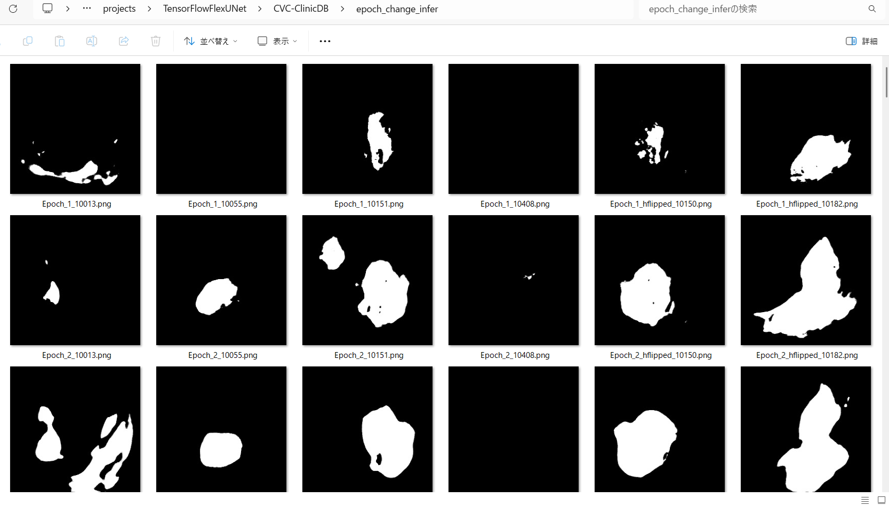 
 
<b>Epoch_change_inference output at middlepoint (epoch 21,22,23)</b> 
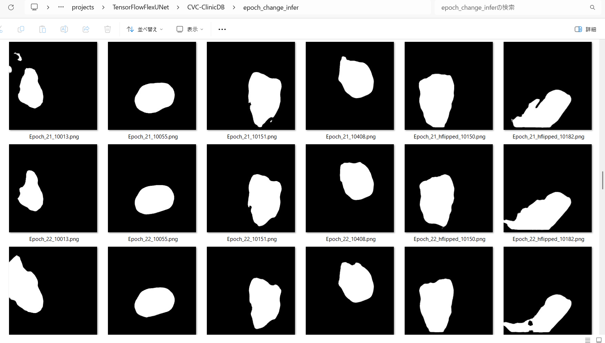 
 
<b>Epoch_change_inference output at ending (epoch 43,44,45)</b> 
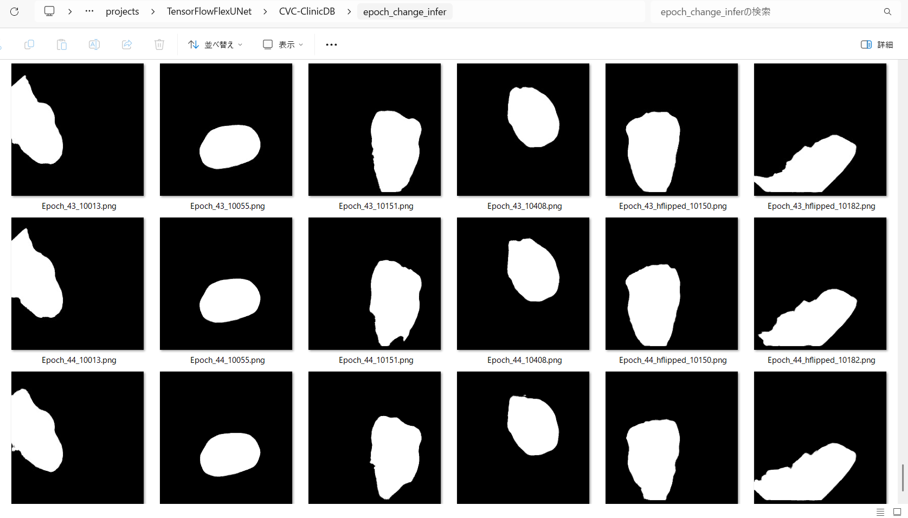 
 
In this experiment, the training process was terminated at epoch 45. 
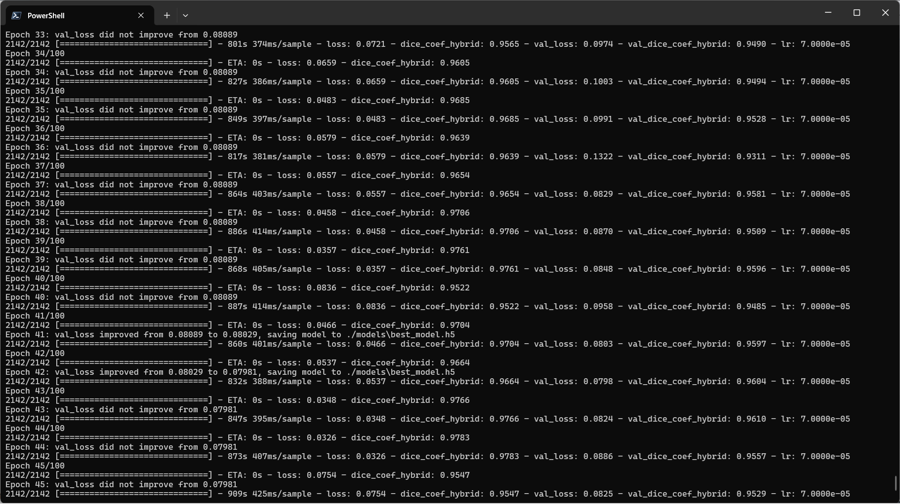 
 
<a href="./projects/TensorFlowFlexUNet/CVC-ClinicDB/eval/train_metrics.csv">train_metrics.csv</a> 
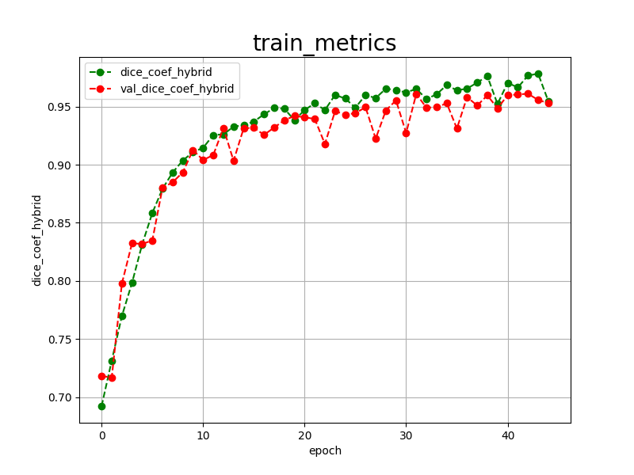 
 
<a href="./projects/TensorFlowFlexUNet/CVC-ClinicDB/eval/train_losses.csv">train_losses.csv</a> 
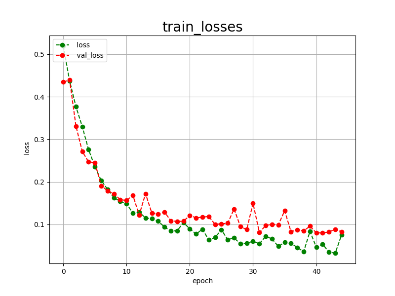 
 
<h3>
4. Evaluation
</h3>
Please move to <b>./projects/TensorFlowFlexUNet/CVC-ClinicDB</b> folder, 
and run the following bat file to evaluate the TensorFlowUNet model for CVC-ClinicDB. 
<pre>
./2.evaluate.bat
</pre>
This runs the following command.
<pre>
python ../../../src/TensorFlowFlexUNetEvaluator.py ./train_eval_infer.config
</pre>

Evaluation console output: 
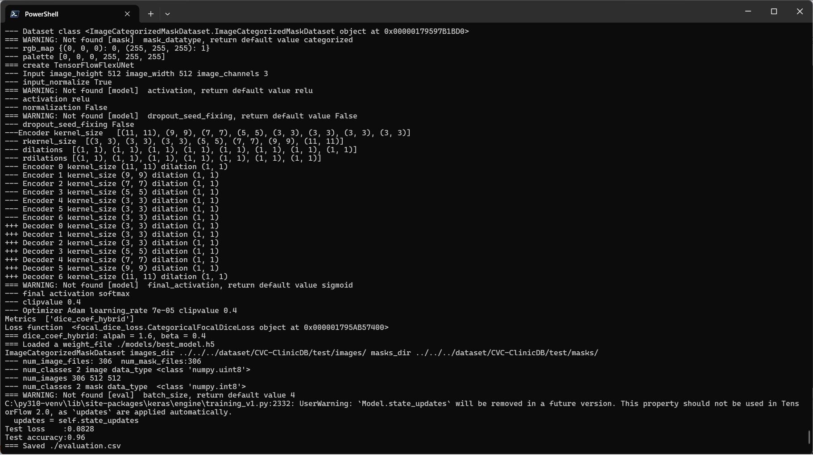
  Image-Segmentation-CVC-ClinicDB

<a href="./projects/TensorFlowFlexUNet/CVC-ClinicDB/evaluation.csv">evaluation.csv</a> 
The loss (categorical_focal_dice_loss) on this CVC-ClinicDB/test was not low, but dice_coef_hybrid was high, as shown below.
 
<pre>
categorical_focal_dice_loss,0.0828
dice_coef_hybrid,0.96
</pre>
 

<h3>
5. Inference
</h3>
Please move to <b>./projects/TensorFlowFlexUNet/CVC-ClinicDB</b> folder
and run the following bat file to infer segmentation regions for images using the trained TensorFlowUNet model for CVC-ClinicDB. 
<pre>
./3.infer.bat
</pre>
This runs the following command.
<pre>
python ../../../src/TensorFlowFlexUNetInferencer.py ./train_eval_infer.config
</pre>

<b>mini_test_images</b> 
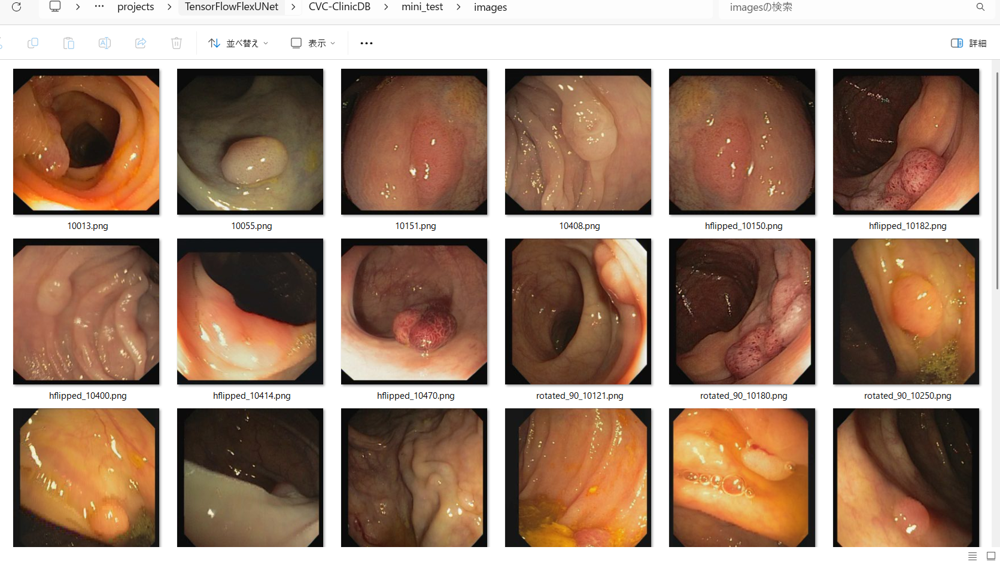 
<b>mini_test_mask(ground_truth)</b> 
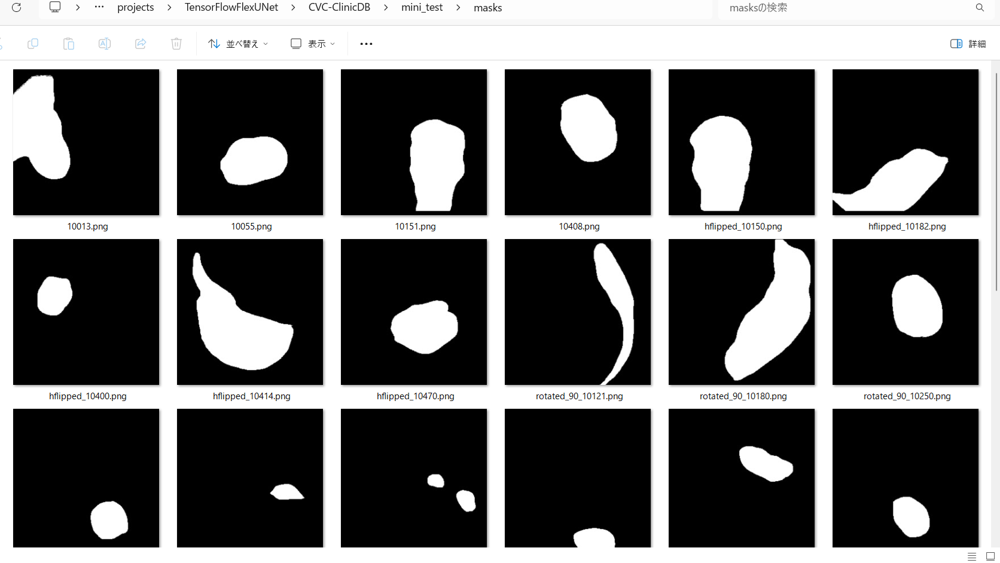 

<b>Inferred test masks</b> 
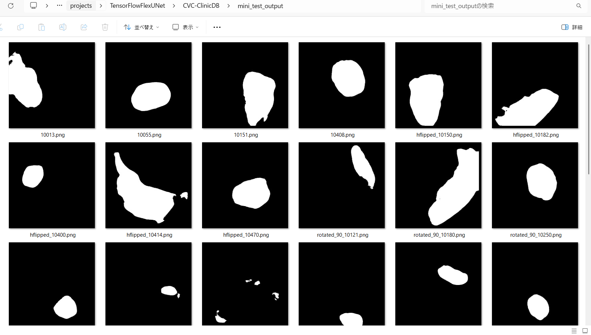 
 

<b>Enlarged images and masks for CVC-ClinicDB Images of 256x256 pixels</b> 
As shown below, the inferred masks look similar to the ground truth masks except for the first and ixth cases. 
 
<table>
<tr>
<th width="320" height="auto">Image</th>
<th width="320" height="auto">Mask (ground_truth)</th>
<th width="320" height="auto">Inferred-mask</th>
</tr>
<tr>
<td>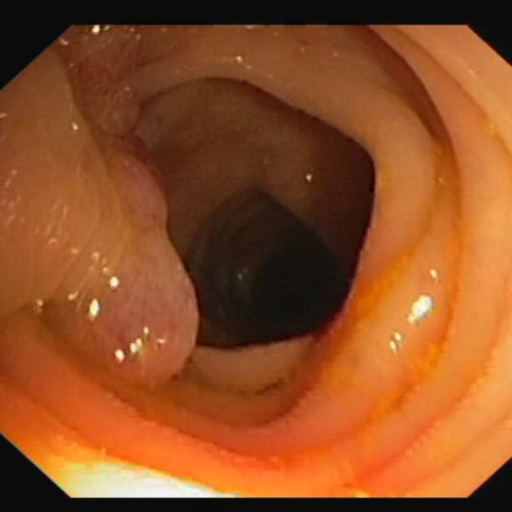</td>
<td></td>
<td></td>
</tr>
<tr>
<td>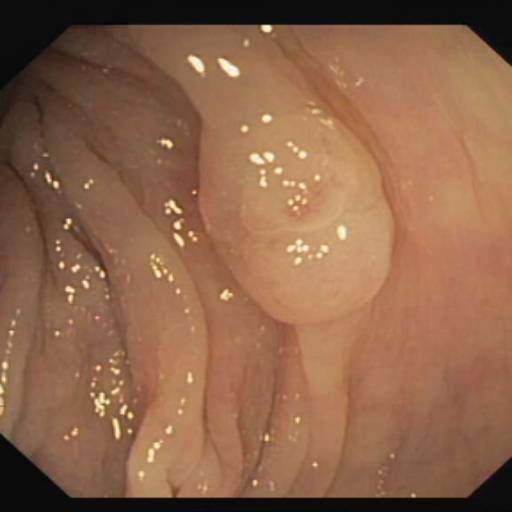</td>
<td></td>
<td></td>
</tr>
<tr>
<td>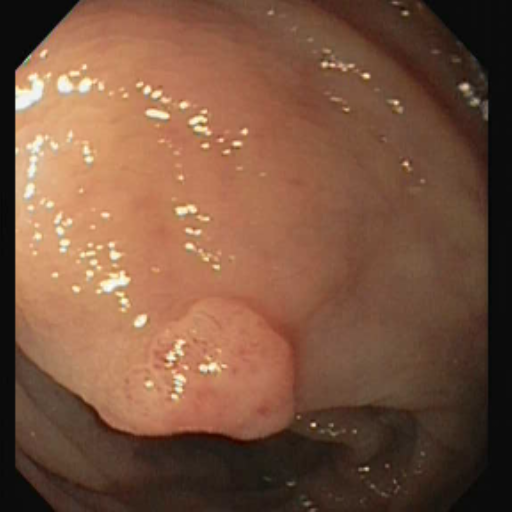</td>
<td></td>
<td></td>
</tr>
<tr>
<td>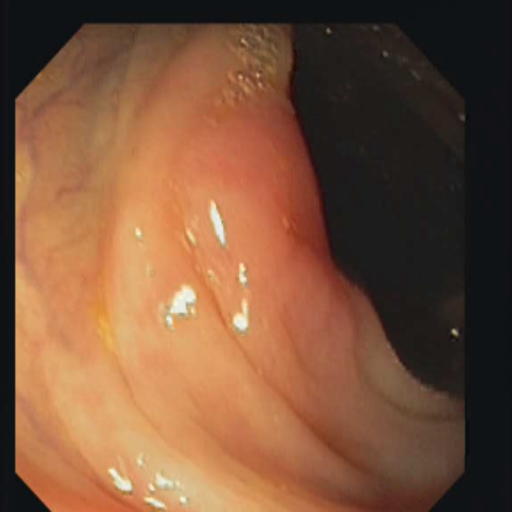</td>
<td></td>
<td></td>
</tr>
<tr>
<td>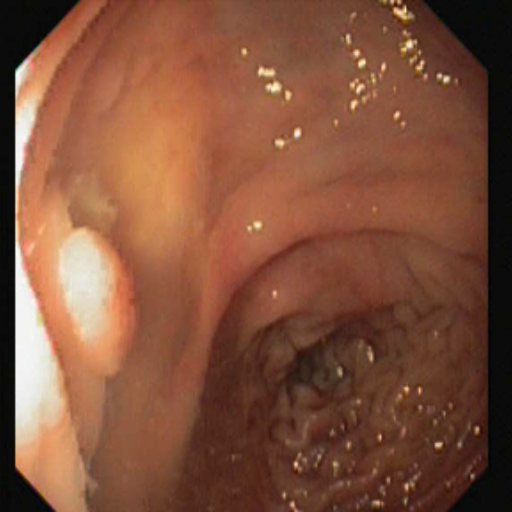</td>
<td></td>
<td></td>
</tr>
<tr>
<td>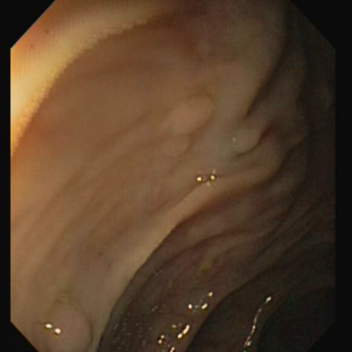</td>
<td></td>
<td></td>
</tr>
</table>

 
<h3>
References
</h3>
<b>1. TensorFlow-FlexUNet-Image-Segmentation-CVC-ColonDB</b> 
Toshiyuki Arai 
<a href="https://github.com/sarah-antillia/TensorFlow-FlexUNet-Image-Segmentation-CVC-ColonDB">
https://github.com/sarah-antillia/TensorFlow-FlexUNet-Image-Segmentation-CVC-ColonDB
</a>
  
<b>2. TensorFlow-FlexUNet-Image-Segmentation-Colonoscopy-Child-Polyp</b> 
Toshiyuki Arai 
<a href="https://github.com/sarah-antillia/TensorFlow-FlexUNet-Image-Segmentation-Colonoscopy-Child-Polyp">
https://github.com/sarah-antillia/TensorFlow-FlexUNet-Image-Segmentation-Colonoscopy-Child-Polyp
</a>
  
<b>3. TensorFlow-FlexUNet-Image-Segmentation-Sessile-Polyp </b> 
Toshiyuki Arai 
<a href="https://github.com/sarah-antillia/TensorFlow-FlexUNet-Image-Segmentation-Sessile-Polyp">
https://github.com/sarah-antillia/TensorFlow-FlexUNet-Image-Segmentation-Sessile-Polyp
</a>
  
<b>4. TensorFlow-FlexUNet-Image-Segmentation-Multiclass-Gastrointestinal-Disease </b> 
Toshiyuki Arai 
<a href="https://github.com/sarah-antillia/TensorFlow-FlexUNet-Image-Segmentation-Multiclass-Gastrointestinal-Disease">
https://github.com/sarah-antillia/TensorFlow-FlexUNet-Image-Segmentation-Multiclass-Gastrointestinal-Disease
</a>
  
<b>5. TensorFlow-FlexUNet-Image-Segmentation-Model</b> 
Toshiyuki Arai 
<a href="https://github.com/sarah-antillia/TensorFlow-FlexUNet-Image-Segmentation-Model">
https://github.com/sarah-antillia/TensorFlow-FlexUNet-Image-Segmentation-Model
</a>
  
